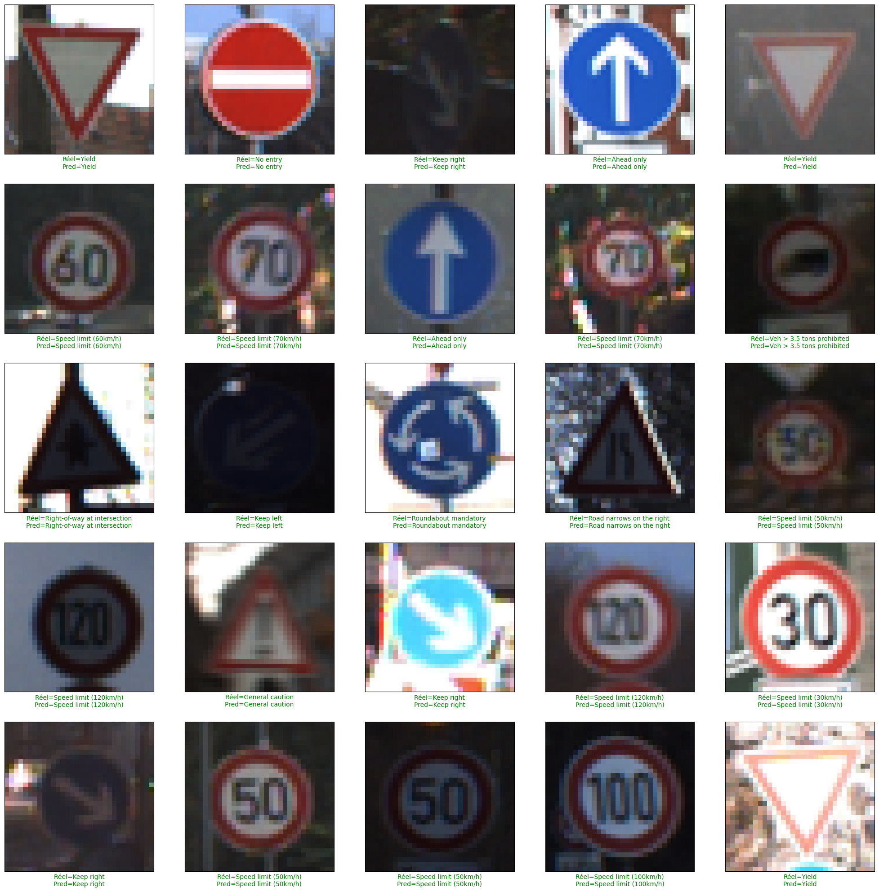
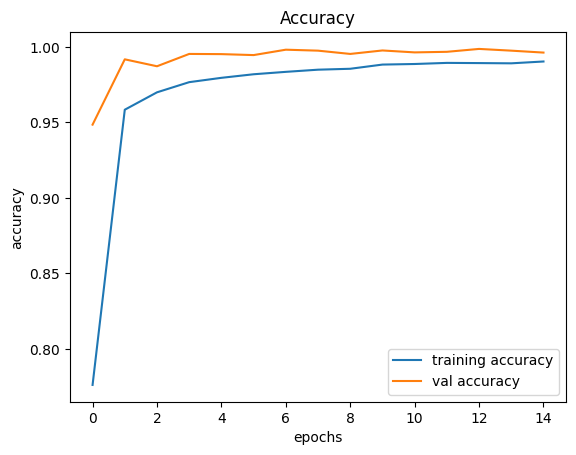

# Traffic Sign Recognition with a CNN and YOLOv8


A two-stage traffic sign pipeline: YOLOv8 proposes regions of interest and a custom CNN classifies each one into 43 sign categories from the [German Traffic Sign Recognition Benchmark](https://www.kaggle.com/datasets/meowmeowmeowmeowmeow/gtsrb-german-traffic-sign) (GTSRB).



## Results

Evaluated on the 12,630 images of the independent GTSRB test set:

| Metric | Value |
| --- | --- |
| Test accuracy | **97.94%** |
| Test loss | 0.091 |
| Macro F1-score | 0.97 |
| Weighted F1-score | 0.98 |

Most classes exceed 0.95 precision and recall. A few under-represented classes score lower, which is consistent with the dataset's class imbalance.



## Method

1. **Data:** download GTSRB with `kagglehub`, resize images to 32×32, split into training and validation sets, and apply data augmentation.
2. **Classifier:** a sequential CNN with four convolutional layers, max pooling, batch normalization, a 512-unit dense layer and dropout, trained for 15 epochs with Adam.
3. **Detection:** `detect_and_classify` runs YOLOv8n, then passes each detected region to the CNN.

> **Limitation:** the detector uses the pretrained `yolov8n.pt` weights and was not retrained on traffic signs. The accuracy above measures the CNN classifier only, and no detection metric such as mAP was computed. Training YOLOv8 on a dedicated sign detection dataset would be the natural next step.

## Getting started

```bash
pip install -r requirements.txt
jupyter notebook traffic_sign_detection_classification.ipynb
```

The dataset is downloaded automatically through `kagglehub`, which may require Kaggle credentials. A GPU is recommended.

## Author

**Yassine Houari** · [LinkedIn](https://www.linkedin.com/in/yassine-houari-/)
