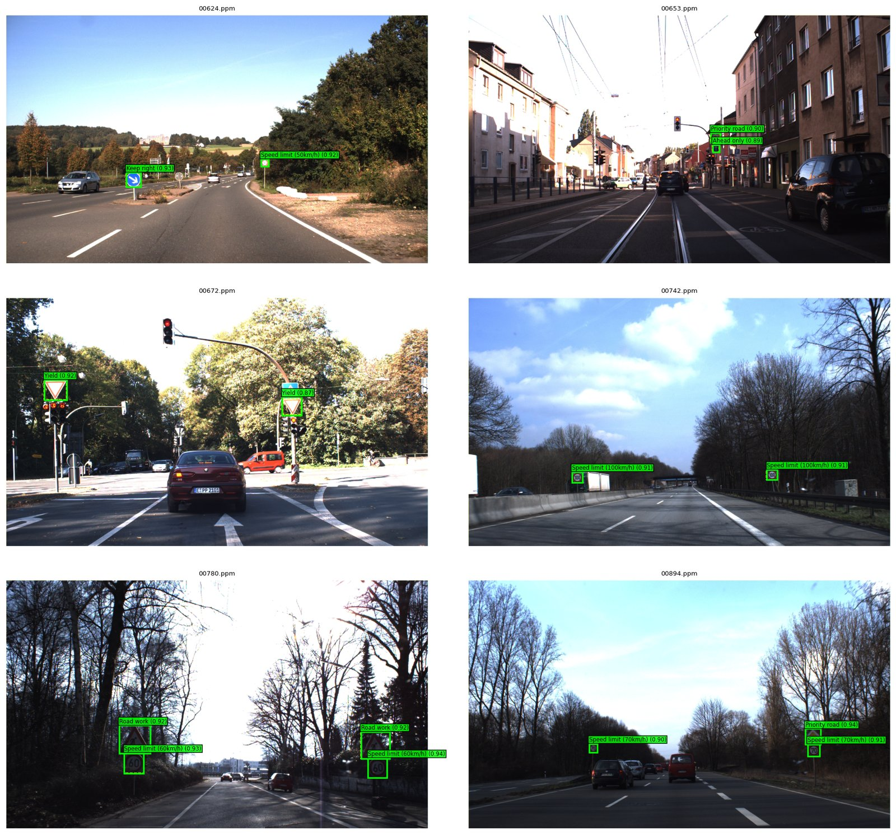
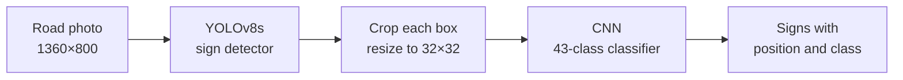
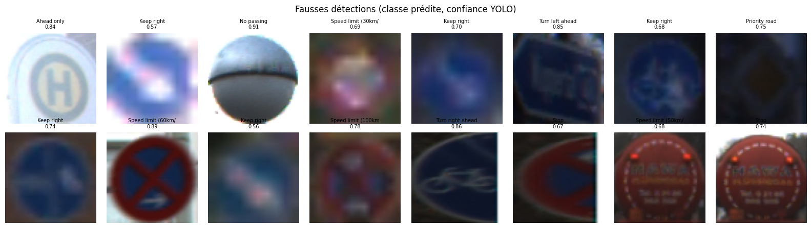
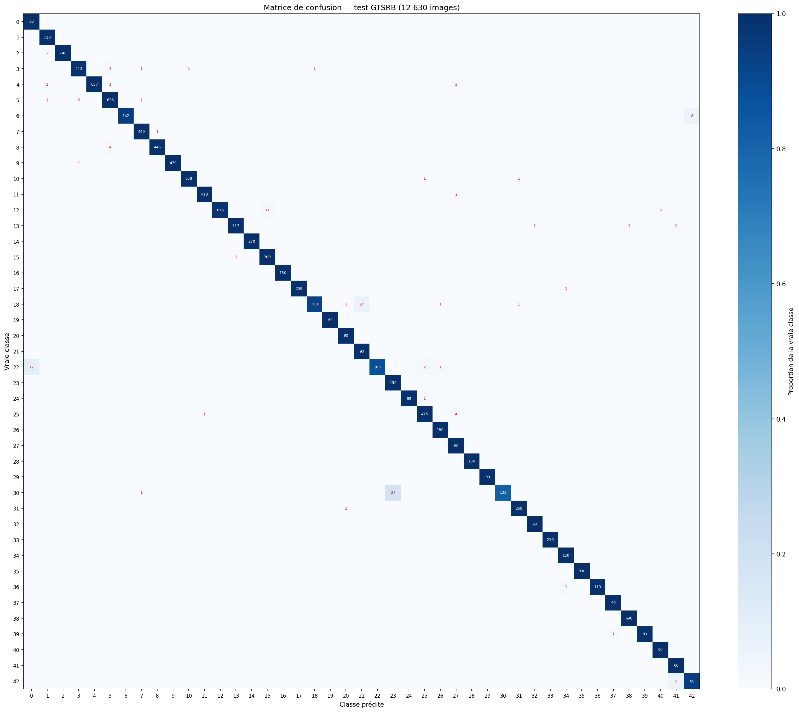
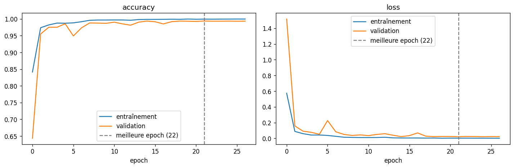
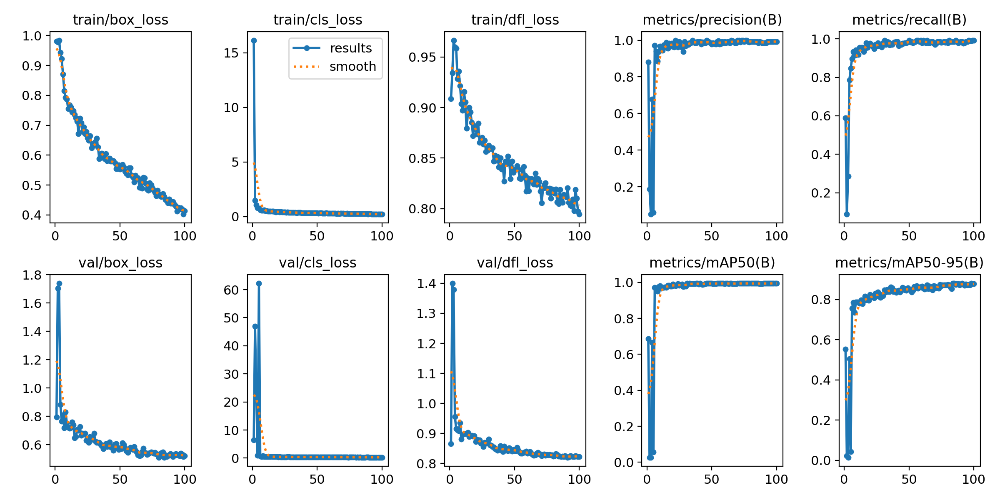
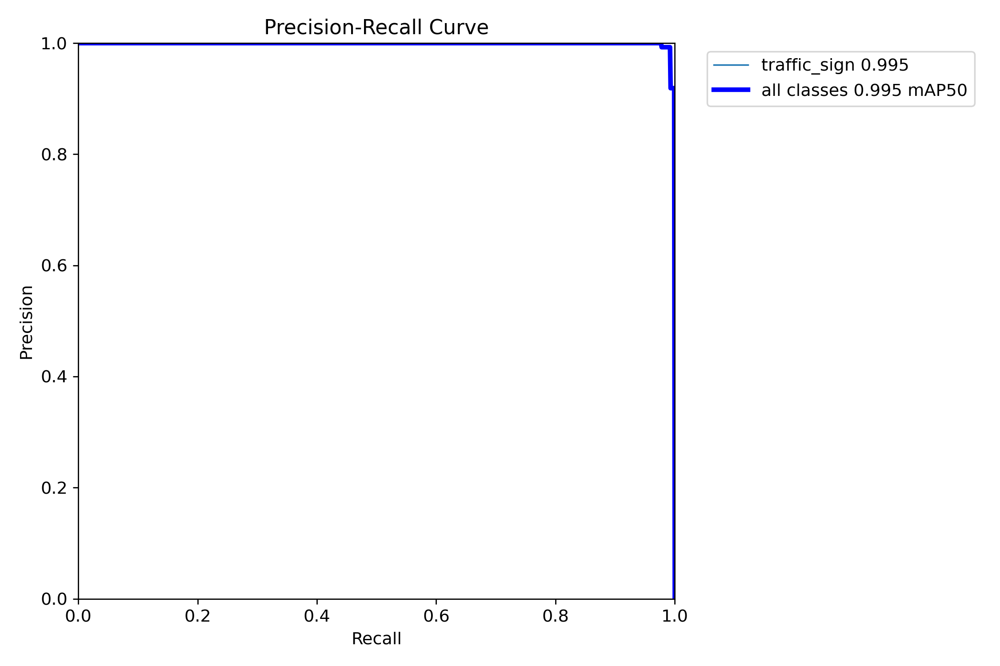

# Traffic Sign Detection and Recognition with YOLOv8 and a CNN


A two-stage system that finds and identifies traffic signs in real road photos:

1. **Detection:** a YOLOv8s model, fine-tuned on the [GTSDB](https://benchmark.ini.rub.de/gtsdb_dataset.html) detection benchmark, locates every sign in the image.
2. **Recognition:** a CNN trained on [GTSRB](https://www.kaggle.com/datasets/meowmeowmeowmeowmeow/gtsrb-german-traffic-sign) classifies each detected sign into one of 43 classes.



*Test scenes never seen during training. Green boxes show the predicted class and the YOLO confidence; dashed yellow boxes are the ground truth.*

## Results

| Stage | Test set | Metric | Result |
| --- | --- | --- | --- |
| Classification (CNN) | GTSRB, 12,630 images | Accuracy / macro F1 | **98.89%** / 0.979 |
| Detection (YOLOv8s) | GTSDB, 300 photos, 361 signs | mAP@0.5 / mAP@0.5:0.95 | **0.993** / 0.897 |
| Full pipeline | GTSDB, 300 photos, 361 signs | End-to-end recall / precision | **98.9%** / 95.5% |

In the full pipeline, a sign counts as correct only if it is detected (IoU ≥ 0.5) **and** given the right class. All metrics are in [`results/metrics.json`](results/metrics.json).

## Pipeline



## Data

| Dataset | Content | Used for |
| --- | --- | --- |
| **GTSRB** | 51,839 cropped sign images, 43 classes | training and testing the classifier |
| **GTSDB** | 900 road photos (1360×800) with 1,213 annotated signs | training and testing the detector |

GTSRB only contains signs that are already cropped, so a detector cannot learn from it. GTSDB provides full road scenes from the same research group, with the same 43 classes, which lets both models work together.

## Method

**Classifier (GTSRB)**
- Images are cropped to the sign region (ROI) and resized to 32×32.
- **The validation split is made by physical sign, not by image.** GTSRB comes from video, so each sign appears in a track of about 30 near-identical frames. A random image split would put frames of the same sign on both sides and inflate validation scores. Here, 20% of the tracks of each class go to validation, and all 43 classes are present on both sides.
- On-the-fly GPU augmentation: rotation (±15°), zoom, translation and contrast. There is no horizontal flip, because it would turn "keep right" into "keep left".
- The CNN has 4 convolutional layers, batch normalization, a 512-unit dense layer and dropout. It is trained with Adam, early stopping and learning-rate reduction. The best epoch was 22, with 99.37% validation accuracy.

**Detector (GTSDB)**
- **Single class (`traffic_sign`):** with about 700 training boxes, 43 detection classes would leave too few examples per class. The detector finds signs and the CNN, trained on about 31,000 images, names them.
- **Trained at 1280 px instead of the default 640 px.** Signs are small: their median width is 38 px and 25% are under 28 px. At 640 px the smallest ones would shrink to about 8 px.
- YOLOv8s starts from COCO weights. It is trained for 100 epochs, which takes 55 minutes on a Tesla T4.
- Split: photos 0 to 599 are used for training (510) and validation (90). Photos 600 to 899 form the test set (300), which is the official GTSDB split.

## Error analysis and limitations

- **CNN errors are concentrated:** 140 errors out of 12,630 images, mostly a few physical signs in very dark or overexposed tracks. The most frequent confusions are between triangular warning signs that differ only by a small central pictogram, for example "beware of ice/snow" and "slippery road".
- **Most "false" detections are real signs.** About 12 of the 16 false detections are signs outside the 43 classes, such as bus stops, no-parking signs and cycle paths, which GTSDB does not annotate.
- **Closed set:** the CNN has no "other" class, so such signs are still assigned one of the 43 labels.
- **Small signs:** the 3 missed signs are 16 to 30 px wide.
- **Limited test set:** the detection test set is small (361 signs) and contains only German roads.



## Repository structure

```
├── notebooks/
│   └── traffic_sign_detection_recognition.ipynb   # full workflow with outputs (comments in French)
├── src/
│   └── predict.py              # inference on a road photo
├── results/
│   ├── metrics.json
│   └── figures/                # confusion matrix, training curves, YOLO curves, demos
└── requirements.txt
```

## Usage

**Run inference on your own photo:**

```bash
pip install -r requirements.txt
```

Download `gtsdb_yolov8s_detector.pt` and `gtsrb_cnn_classifier.keras` from the [v2.0 release](https://github.com/Yassine-Houari/traffic-sign-detection-recognition/releases/tag/v2.0) into a `models/` folder, then run:

```bash
python src/predict.py --image road.jpg
```

The script prints each sign found and saves `road_pred.jpg` with the boxes and class names drawn on it.

**Reproduce the training:** open `notebooks/traffic_sign_detection_recognition.ipynb` in Google Colab with a GPU. Both datasets are downloaded inside the notebook.

## More figures

| CNN confusion matrix (GTSRB test) | CNN training curves |
| --- | --- |
|  |  |

| YOLOv8s training | YOLOv8s precision-recall curve |
| --- | --- |
|  |  |

## Author

**Yassine Houari** · [LinkedIn](https://www.linkedin.com/in/yassine-houari-/)
